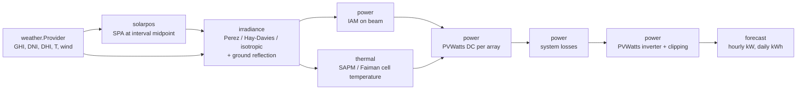

# pvforecast-go

[](https://github.com/kviatkovsky/pvforecast-go/actions/workflows/ci.yml)
[](https://pkg.go.dev/github.com/kviatkovsky/pvforecast-go)
[](https://goreportcard.com/report/github.com/kviatkovsky/pvforecast-go)
[](https://scorecard.dev/viewer/?uri=github.com/kviatkovsky/pvforecast-go)
[](https://github.com/kviatkovsky/pvforecast-go/releases)
[](LICENSE)

**Physics-based photovoltaic power forecasting in Go.** Describe a PV system
(location, kWp, tilt, azimuth, losses), and `pvforecast` fetches a weather
forecast and returns hourly AC power and daily energy for the next 1–7 days.

Every model is a published, textbook method (NREL SPA, Perez, PVWatts v5)
and is **validated against [pvlib python](https://github.com/pvlib/pvlib-python)
to within 1e-6 or better**, model by model and end to end. The library has
**no dependencies outside the Go standard library**, does not allocate per
time step, and computes a year of hourly data in about 60 ms.

- [Install](#install) · [Command line](#command-line) · [Library](#library)
- [Physics](#physics) · [Accuracy](#accuracy) · [Timestamp convention](#timestamp-convention)
- [Benchmarks](#benchmarks) · [Limitations](#limitations) · [Roadmap](#roadmap) · [References](#references)

## Install

```bash
go install github.com/kviatkovsky/pvforecast-go/cmd/pvforecast@latest
```

Prebuilt binaries for Linux, macOS and Windows (amd64, arm64) are attached to
each [release](https://github.com/kviatkovsky/pvforecast-go/releases), with
an SBOM per archive and a checksum file signed keylessly with
[Sigstore](https://www.sigstore.dev/); the release notes show the
`cosign verify-blob` command.

## Command line

```bash
pvforecast --lat 50.06 --lon 19.94 --kwp 10 --tilt 35 --azimuth 180 --days 2 --tz Europe/Warsaw
```

```text
PV system · 50.0600, 19.9400 · 10.0 kWp in 1 array(s) · inverter 9.09 kW · losses 14.1 %
Weather: open-meteo, interval-end · sky model: perez · times in Europe/Warsaw

                  PERIOD  POA W/m²  CELL °C  DC kW  AC kW
  2026-06-20 11:00–12:00       997     47.0   7.81   7.51
  2026-06-20 12:00–13:00      1043     49.5   8.08   7.77
  ...

        DATE  ENERGY kWh  kWh/kWp
  2026-06-20        64.7     6.47
  2026-06-21        64.7     6.47
       TOTAL       129.4    12.94
```

(Excerpt of the clear-sky test fixture; real output depends on the weather.)

Multi-array systems are described in JSON, see
[`examples/system.json`](examples/system.json):

```bash
pvforecast --config examples/system.json --format json
```

| Flag | Default | Meaning |
|---|---|---|
| `--lat`, `--lon`, `--altitude` | — | site, degrees and meters |
| `--kwp`, `--tilt`, `--azimuth` | —, 35, 180 | single array; azimuth clockwise from north |
| `--days` | 2 | local calendar days including today, 1–7 |
| `--model` | `perez` | `perez`, `haydavies` or `isotropic` |
| `--solarpos` | `spa` | `spa` or `noaa` |
| `--losses` | 14.08 | total system losses, % |
| `--dcac` | 1.1 | DC/AC ratio, sets the inverter rating |
| `--config` | — | JSON system file (replaces the system flags) |
| `--format` | `table` | `table`, `json` or `csv` |
| `--tz` | `Local` | IANA time zone for display and daily totals |
| `--instant` | false | use instantaneous instead of hourly-mean irradiance |
| `--log-level` | `warn` | `debug`, `info`, `warn`, `error` (to stderr) |

Exit codes: 0 success, 1 runtime error (for example, the weather service is
unreachable), 2 usage error. `pvforecast version` prints the version.

## Library

```go
package main

import (
	"context"
	"fmt"
	"log"
	"time"

	"github.com/kviatkovsky/pvforecast-go/forecast"
	"github.com/kviatkovsky/pvforecast-go/power"
	"github.com/kviatkovsky/pvforecast-go/weather/openmeteo"
)

func main() {
	sys := forecast.System{
		Name: "Warehouse", Lat: 50.0647, Lon: 19.9450, AltitudeM: 219,
		Arrays: []forecast.Array{
			{Name: "east", KWp: 24, TiltDeg: 12, AzimuthDeg: 90},
			{Name: "west", KWp: 24, TiltDeg: 12, AzimuthDeg: 270},
		},
		Inverter: power.Inverter{RatedACW: 40_000},
		Losses:   power.DefaultLosses,
	}
	opt := forecast.DefaultOptions() // Perez + SPA
	opt.Location, _ = time.LoadLocation("Europe/Warsaw")

	ctx, cancel := context.WithTimeout(context.Background(), 30*time.Second)
	res, err := forecast.Run(ctx, openmeteo.New(), sys, 3, opt)
	cancel()
	if err != nil {
		log.Fatal(err)
	}
	for _, d := range res.Daily {
		fmt.Printf("%s  %.1f kWh\n", d.Date, d.KWh)
	}
}
```

The same program is in [`examples/quickstart`](examples/quickstart).
`forecast.Compute(sys, series, opt)` is the pure core: give it any
`weather.Series` (your own provider, historical data, a test fixture) and it
performs no I/O. Each physics package (`solarpos`, `irradiance`, `thermal`,
`power`) is usable on its own; see the
[package documentation](https://pkg.go.dev/github.com/kviatkovsky/pvforecast-go).

## Physics



| Stage | Model | Reference | Package |
|---|---|---|---|
| Solar position | NREL Solar Position Algorithm | Reda & Andreas (2004) | `solarpos` |
| Solar position (fast) | NOAA Solar Calculator | Meeus (1998) | `solarpos` |
| Decomposition | Erbs diffuse fraction | Erbs, Klein & Duffie (1982) | `irradiance` |
| Air mass | Kasten-Young | Kasten & Young (1989) | `irradiance` |
| Sky diffuse | Isotropic | Liu & Jordan (1963) | `irradiance` |
| Sky diffuse | Hay-Davies | Hay & Davies (1980) | `irradiance` |
| Sky diffuse | Perez (allsitescomposite1990) | Perez et al. (1990) | `irradiance` |
| Ground reflection | Isotropic ground, albedo 0.25 | — | `irradiance` |
| Incidence angle | Physical (Fresnel + Bouguer) | De Soto et al. (2006) | `power` |
| Incidence angle | ASHRAE | Souka & Safwat (1966) | `power` |
| Cell temperature | SAPM | King et al. (2004) | `thermal` |
| Cell temperature | Faiman | Faiman (2008) | `thermal` |
| DC power, losses, inverter | PVWatts v5 | Dobos (2014) | `power` |

Design decisions, including where and why the code deviates from pvlib, are
recorded in [`docs/adr`](docs/adr).

## Accuracy

### Against pvlib


Reference values come from [pvlib python](https://github.com/pvlib/pvlib-python)
0.16.1, generated by [`tools/fixtures/gen.py`](tools/fixtures/gen.py) for seven
sites (Kraków, Madrid, Tromsø, Singapore, Sydney, McMurdo and a point on the
antimeridian) over a year of samples plus dates from 1950 to 2100.

| Quantity | SPA vs pvlib `spa_python` | NOAA vs pvlib (sun above horizon) |
|---|---|---|
| Zenith | ≤ 1e-10° | ≤ 0.014° |
| Apparent zenith | ≤ 1e-10° | ≤ 0.018° (elevation > 10°) |
| Angular separation | — | ≤ 0.015° |
| Azimuth | ≤ 1e-10° | ≤ 0.047° (zenith > 10°) |
| Earth–Sun distance | ≤ 1e-10 AU | ≤ 7.5e-5 AU |

SPA errors are limited by the ten decimal places stored in the fixtures. The
SPA implementation also reproduces the worked example of the NREL report
(Table A5.1). Tests enforce a tolerance of 1e-6° for SPA.

Irradiance models are compared with pvlib over 3,202 samples covering five
sites, six tilts (0–90°), five orientations, four cloud levels, three albedos,
all eight Perez sky-clearness bins and zenith angles up to 89.98°:

| Quantity | Max error vs pvlib | Test tolerance |
|---|---|---|
| Angle of incidence | 1.1e-8° | 1e-6° |
| Beam, ground-reflected, isotropic | 6.2e-8 W/m² | 1e-6 W/m² |
| Hay-Davies (total and components) | 4.2e-8 W/m² | 1e-6 W/m² |
| Perez (total and components) | 2.3e-7 W/m² | 1e-6 W/m² |
| Erbs DNI / DHI | 5.7e-9 W/m² | 1e-6 W/m² |
| Kasten-Young air mass | 5.0e-9 | 1e-7 |
| Cell temperature, Faiman and four SAPM mountings | 5.0e-9 K | 1e-7 K |
| PVWatts DC power | 1.8e-12 W | 1e-6 W |
| PVWatts inverter (part load to clipping) | 4.9e-9 W | 1e-6 W |
| IAM, physical and ASHRAE | 4.9e-9 | 1e-7 |
| PVWatts losses (default 14.08 %) | < 1e-8 % | 1e-7 % |

The complete pipeline (SPA → Perez or Hay-Davies → physical IAM → SAPM
cell temperature → PVWatts DC → losses → PVWatts inverter) is also compared
end to end with the same chain assembled from pvlib functions, for a
south-facing and an east-west system over three days of hourly data: AC
power, DC power, plane-of-array irradiance and cell temperature agree to
within 5e-9 (kW, W/m², °C).

Behavior near the horizon and for negative inputs is documented in
[ADR 0004](docs/adr/0004-irradiance-edge-conventions.md). Regenerate the
reference data with `make fixtures` (Python 3 and
[`tools/fixtures/requirements.txt`](tools/fixtures/requirements.txt)).

### Against PVGIS

[`examples/validation`](examples/validation) compares one year of hourly
output for a 1 kWp south-facing system in Kraków with PVGIS (EU JRC), feeding
this library the PVGIS satellite irradiance. PVGIS models PV output itself,
so this is a cross-model comparison, not a comparison with measurements.

```bash
go run ./examples/validation -fetch
```

> **Results pending.** The PVGIS API was not reachable from the environment
> in which this release was prepared, so no numbers are published yet. The
> comparison code and its metrics (MAE, RMSE, MBE, annual yield) are tested.

## Timestamp convention

Open-Meteo reports hourly radiation as the **mean over the preceding hour,
labeled at the end of the hour**: the value at 12:00 covers 11:00–12:00.
Evaluating the sun at the label instead of the middle of the interval shifts
the geometry by 30 minutes and changes individual morning and evening hours
by 10 % or more.

- Every `weather.Series` carries its interval and a label: `IntervalEnd`,
  `IntervalStart` or `Instant`.
- Solar geometry is evaluated at the representative instant: the interval
  midpoint for means, the timestamp itself for instantaneous values
  (`--instant`, Open-Meteo `_instant` variables).
- Energy is attributed to the local date of that instant.
- The CLI prints periods (`11:00–12:00`) rather than bare timestamps.

A test checks that the three labelings of the same data give identical
results. See [ADR 0006](docs/adr/0006-timestamp-convention.md).

## Benchmarks

| Benchmark (Xeon 2.8 GHz) | Time | Allocations |
|---|---|---|
| Solar position, SPA | ≈ 5.5 µs | 0 |
| Solar position, NOAA | ≈ 0.6 µs | 0 |
| Transposition, isotropic / Hay-Davies | ≈ 0.22 µs | 0 |
| Transposition, Perez | ≈ 0.39 µs | 0 |
| `Compute`, one year hourly (8760 samples), SPA | ≈ 60 ms (≈ 7 µs/sample) | 370 per call, 0 per sample |
| `Compute`, one year hourly, NOAA | ≈ 11 ms (≈ 1.3 µs/sample) | 370 per call, 0 per sample |

Run them with `make bench`; compare commits with
[benchstat](https://pkg.go.dev/golang.org/x/perf/cmd/benchstat).

## Limitations

- **Forecast quality is weather forecast quality.** Cloud timing errors
  dominate; the physics here cannot fix them.
- No shading geometry (horizon, near objects, inter-row), no snow model, no
  soiling dynamics; these enter only as constant loss percentages.
- Fixed-tilt arrays only: no single- or dual-axis trackers.
- No bifacial gain, no spectral correction, no degradation over time.
- One inverter per system; per-MPPT behavior is not modeled.
- Wind is used at 10 m by default; see
  [ADR 0005](docs/adr/0005-cell-temperature-and-wind-height.md).
- Open-Meteo's free tier is for non-commercial use.

## Roadmap

- Single-axis trackers and backtracking
- Bifacial irradiance (view-factor model)
- DIRINT decomposition
- More providers: Solcast, ECMWF open data
- HTTP API in a container image
- WebAssembly demo on GitHub Pages

## Contributing

See [CONTRIBUTING.md](CONTRIBUTING.md). Security issues: [SECURITY.md](SECURITY.md).

## References

1. Reda, I., Andreas, A. (2004). *Solar Position Algorithm for Solar Radiation Applications.* NREL/TP-560-34302.
2. Meeus, J. (1998). *Astronomical Algorithms*, 2nd ed. Willmann-Bell.
3. Erbs, D.G., Klein, S.A., Duffie, J.A. (1982). Estimation of the diffuse radiation fraction for hourly, daily and monthly-average global radiation. *Solar Energy* 28(4).
4. Kasten, F., Young, A.T. (1989). Revised optical air mass tables and approximation formula. *Applied Optics* 28, 4735–4738.
5. Liu, B.Y.H., Jordan, R.C. (1963). The long-term average performance of flat-plate solar-energy collectors. *Solar Energy* 7.
6. Hay, J.E., Davies, J.A. (1980). Calculation of the solar radiation incident on an inclined surface. *Proc. First Canadian Solar Radiation Data Workshop*, 59.
7. Perez, R., Ineichen, P., Seals, R., Michalsky, J., Stewart, R. (1990). Modeling daylight availability and irradiance components from direct and global irradiance. *Solar Energy* 44(5), 271–289.
8. De Soto, W., Klein, S.A., Beckman, W.A. (2006). Improvement and validation of a model for photovoltaic array performance. *Solar Energy* 80, 78–88.
9. Souka, A.F., Safwat, H.H. (1966). Determination of the optimum orientations for the double exposure flat-plate collector and its reflections. *Solar Energy* 10, 170–174.
10. King, D.L., Boyson, W.E., Kratochvil, J.A. (2004). *Photovoltaic Array Performance Model.* SAND2004-3535.
11. Faiman, D. (2008). Assessing the outdoor operating temperature of photovoltaic modules. *Progress in Photovoltaics* 16(4), 307–315.
12. Dobos, A.P. (2014). *PVWatts Version 5 Manual.* NREL/TP-6A20-62641.
13. Peterson, E.W., Hennessey, J.P. (1978). On the use of power laws for estimates of wind power potential. *J. Applied Meteorology* 17(3).
14. Holmgren, W.F., Hansen, C.W., Mikofski, M.A. (2018). pvlib python: a python package for modeling solar energy systems. *JOSS* 3(29). Used as the numerical reference; this is an independent implementation.

## Acknowledgements and data

Weather data by [Open-Meteo.com](https://open-meteo.com/), licensed under
[CC BY 4.0](https://creativecommons.org/licenses/by/4.0/). PVGIS data ©
European Union, [JRC](https://joint-research-centre.ec.europa.eu/pvgis-online-tool_en).
Reference values from [pvlib python](https://github.com/pvlib/pvlib-python)
(BSD-3-Clause).

## License

[MIT](LICENSE)
